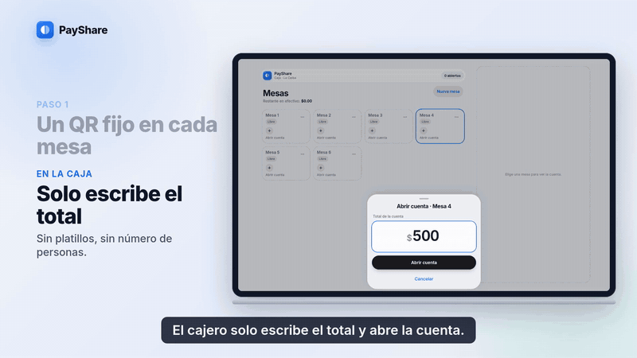
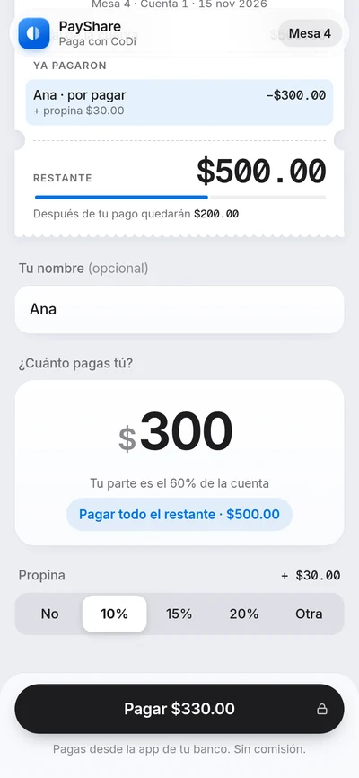
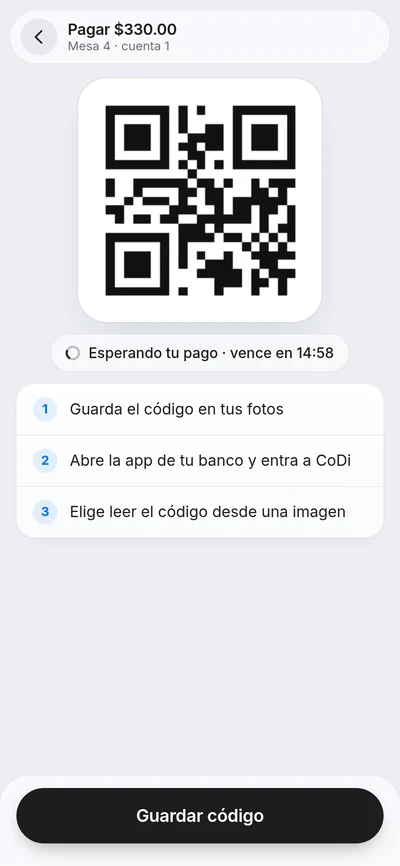
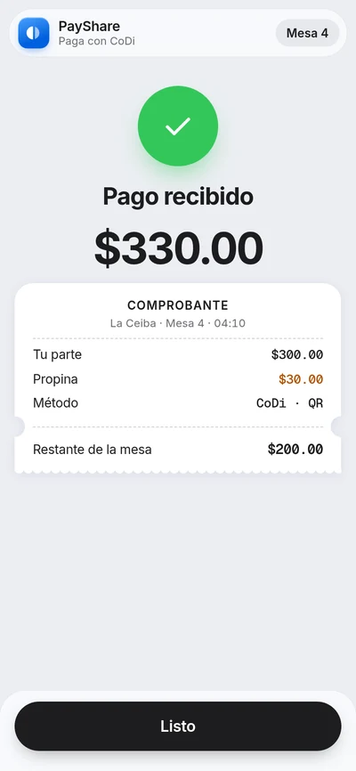
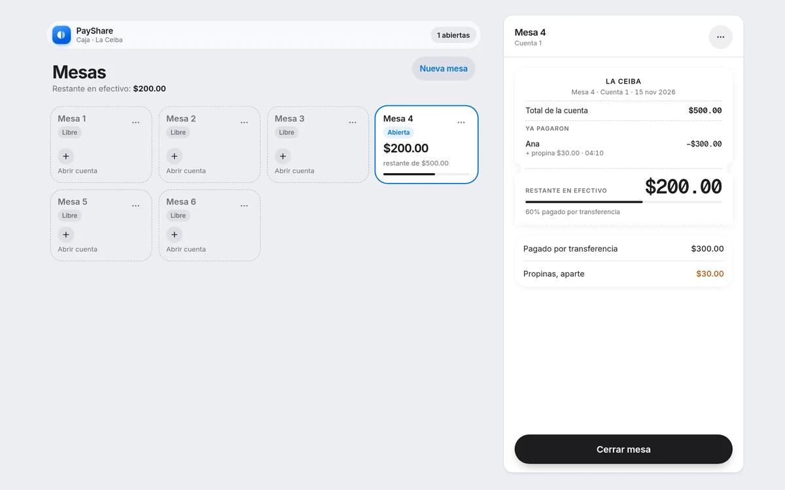
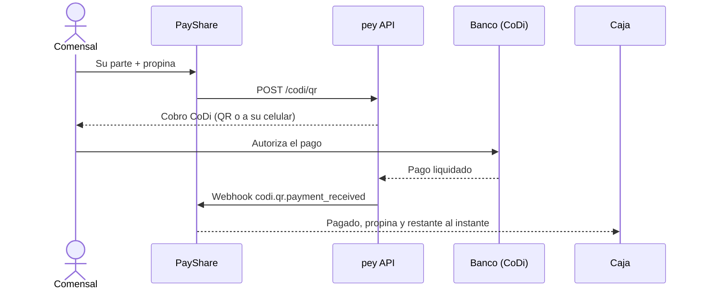

<div align="center">


# PayShare

**Un QR por mesa. Cada quien paga su parte con CoDi y la caja lo ve al instante.**


[**App en vivo**](https://pay-share-one.vercel.app) · [**Video**](https://github.com/ValentinZurita/pay-share/raw/master/docs/video/pay-share.mp4) · [**Caja**](https://pay-share-one.vercel.app/caja) (PIN `977564`)

<a href="https://github.com/ValentinZurita/pay-share/raw/master/docs/video/pay-share.mp4"></a>

<sub>▶ <a href="https://github.com/ValentinZurita/pay-share/raw/master/docs/video/pay-share.mp4">Ver video completo (56 s)</a></sub>

</div>

## El problema

Cuando una mesa paga por separado, la caja revisa transferencias a mano, la propina se revuelve con la venta y nadie sabe cuánto falta en efectivo.

## Cómo funciona

<table>
  <tr>
    <td align="center" width="25%"></td>
    <td align="center" width="25%"></td>
    <td align="center" width="25%"></td>
  </tr>
  <tr>
    <td align="center"><sub><b>1.</b> Escanea el QR y pone su parte + propina</sub></td>
    <td align="center"><sub><b>2.</b> Paga con CoDi desde su banco</sub></td>
    <td align="center"><sub><b>3.</b> Recibe su comprobante</sub></td>
  </tr>
</table>


<p align="center"><sub><b>4.</b> La caja se actualiza sola: pagado por transferencia, propinas aparte y restante en efectivo.</sub></p>

1. El cajero abre la mesa escribiendo solo el total.
2. El comensal escanea el QR fijo de la mesa y escribe cuánto paga y su propina.
3. PayShare genera un cobro CoDi con pey y el comensal lo paga desde su banco, sin app ni comisión.
4. pey avisa del pago y la caja se actualiza al instante.
5. Se cobra el efectivo restante y se cierra la mesa.

## Cómo usa pey



- **Cobro:** [`app/api/pay/route.ts`](app/api/pay/route.ts) crea el pago y [`lib/payments/pey.ts`](lib/payments/pey.ts) llama a `POST /codi/qr` con monto, concepto (`Mesa 4 cuenta 12`), expiración y `numRef`.
- **Confirmación:** [`app/api/webhooks/pey/route.ts`](app/api/webhooks/pey/route.ts) verifica la firma ([Standard Webhooks](https://www.standardwebhooks.com/)) y registra el pago de forma idempotente: un aviso repetido no se cuenta dos veces.

## Pruébalo

1. Entra a la [caja](https://pay-share-one.vercel.app/caja) con el PIN `977564` y abre la **Mesa 4** con un total, por ejemplo `$500`.
2. En el celular u otra pestaña abre la [Mesa 4](https://pay-share-one.vercel.app/mesa/4), escribe tu parte y la propina y paga.
3. Regresa a la caja: verás lo pagado, la propina aparte y lo que falta en efectivo.
4. Cierra la mesa con **Cerrar mesa**.

> La versión publicada usa el modo de prueba de pey mientras se activa la cuenta CLABE; con `PEY_MODE=live` usa el API real.

## Stack

Next.js 16 · React 19 · TypeScript · Tailwind CSS · Supabase · Vercel · API de pey (CoDi)

<details>
<summary><b>Correr localmente</b></summary>

```bash
pnpm install
cp .env.example .env.local
pnpm dev   # http://localhost:3000
```

Con Supabase, ejecuta [`supabase/migrations/0001_init.sql`](supabase/migrations/0001_init.sql) en el SQL Editor (crea 6 mesas). Sin llaves de Supabase y con `PEY_MODE=mock`, las mesas viven en memoria.

| Variable | Uso |
|---|---|
| `NEXT_PUBLIC_SUPABASE_URL` | URL del proyecto de Supabase |
| `NEXT_PUBLIC_SUPABASE_ANON_KEY` | Llave pública `anon` |
| `SUPABASE_SERVICE_ROLE_KEY` | Llave `service_role` (secreta, solo servidor) |
| `NEXT_PUBLIC_BASE_URL` | Dirección del sitio, sin barra final; va dentro de los QR |
| `NEXT_PUBLIC_RESTAURANT_NAME` | Nombre que ve el comensal |
| `PEY_MODE` | `live` para el API de pey; `mock` para probar sin banco |
| `DEMO_MODE` | `true` cobra un monto mínimo de prueba; no lo pongas en `false` con la cuenta de prueba de pey |
| `PEY_API_KEY` | Portal pey → Developer (secreta) |
| `PEY_WEBHOOK_SECRET` | Secreto `whsec_…` del webhook (solo servidor) |
| `CASHIER_PIN` | PIN de la caja; obligatorio en producción |

Comandos: `pnpm test` · `pnpm typecheck` · `pnpm build`

</details>

<details>
<summary><b>Componentes de terceros</b></summary>

Next.js, React, TypeScript, Tailwind CSS, `@supabase/supabase-js`, `qrcode`, `standardwebhooks`, `@vercel/blob` y el API de pey. Construido durante el hackathon con ayuda de herramientas de IA (Cursor).

</details>
