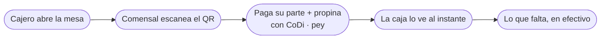

<div align="center">


# PayShare

*Un QR por mesa. Cada quien paga su parte con CoDi y la caja lo ve al instante.*


[App en vivo](https://pay-share-one.vercel.app) &nbsp;·&nbsp; [Video](https://github.com/ValentinZurita/pay-share/raw/master/docs/video/pay-share.mp4) &nbsp;·&nbsp; [Caja](https://pay-share-one.vercel.app/caja)

<br />

<a href="https://github.com/ValentinZurita/pay-share/raw/master/docs/video/pay-share.mp4"></a>

<sub>▶ <a href="https://github.com/ValentinZurita/pay-share/raw/master/docs/video/pay-share.mp4">Ver el video completo · 56 s</a></sub>

</div>

<br />

## El problema

Cuando una mesa paga por separado, la caja revisa transferencias a mano, la propina se revuelve con la venta y nadie sabe cuánto falta.

## La solución

Un QR fijo en cada mesa. Cada comensal paga lo suyo con CoDi, sin terminal ni app, y la caja ve todo en tiempo real.



## Cómo usa pey

- **Cobro CoDi dinámico** con `POST /codi/qr` por cada parte. <sub>[`lib/payments/pey.ts`](lib/payments/pey.ts)</sub>
- **Webhook firmado** `codi.qr.payment_received` que actualiza la caja al instante. <sub>[`app/api/webhooks/pey/route.ts`](app/api/webhooks/pey/route.ts)</sub>

## Pruébalo

1. Entra a la [caja](https://pay-share-one.vercel.app/caja) (sin PIN en la demo). En la **Mesa 5** toca **Abrir cuenta** y escribe un total, por ejemplo `500`.
2. Abre la [Mesa 5](https://pay-share-one.vercel.app/mesa/5) en tu celular. Escribe cuánto pagas, elige la propina, toca **Pagar** y luego **Código QR**. Paga el QR desde tu app de banco con CoDi.
3. Vuelve a la caja: verás lo pagado por transferencia, la propina aparte y el restante en efectivo. Toca **Cerrar mesa** para dejarla libre.

<sub>💸 La versión publicada usa la API de pey en producción (`PEY_MODE=live`). Para el demo, `DEMO_MODE` cobra solo **$0.01 MXN** por pago, a una cuenta de pruebas de pey (no se devuelve).</sub>

**Stack:** Next.js · React · TypeScript · Tailwind CSS · Supabase · Vercel · API de pey

<br />

<details>
<summary><b>Correr localmente</b></summary>

<br />

```bash
pnpm install
cp .env.example .env.local   # llena las variables
pnpm dev                      # http://localhost:3000
```

Con Supabase, ejecuta [`supabase/migrations/0001_init.sql`](supabase/migrations/0001_init.sql). Sin llaves y con `PEY_MODE=mock`, las mesas viven en memoria. Las variables están descritas en [`.env.example`](.env.example).

Comandos: `pnpm test` · `pnpm typecheck` · `pnpm build`

</details>

<details>
<summary><b>Componentes de terceros</b></summary>

<br />

Next.js, React, TypeScript, Tailwind CSS, `@supabase/supabase-js`, `qrcode`, `standardwebhooks`, `@vercel/blob` y el API de pey. Hecho durante el Cursor Hackatón México (Villahermosa) con ayuda de Cursor.

</details>
